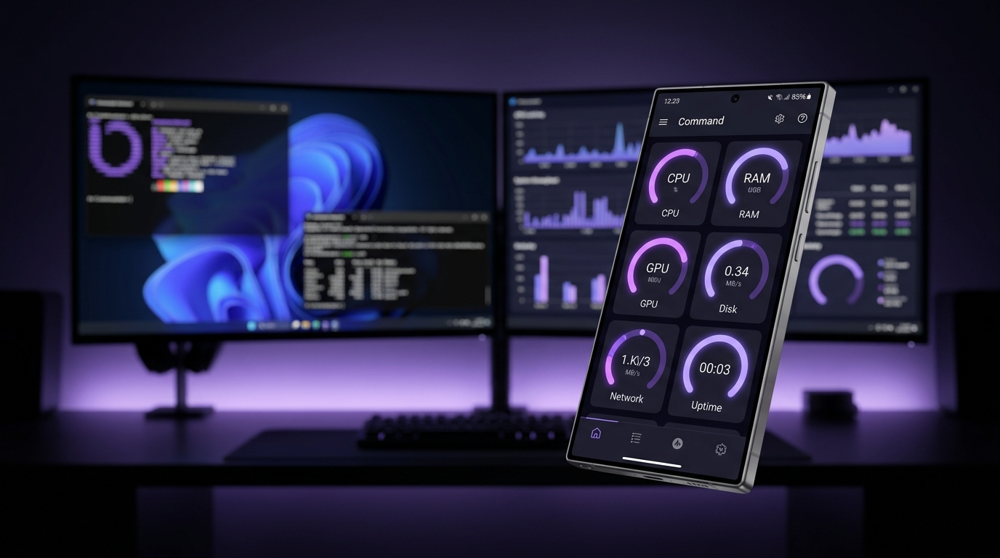
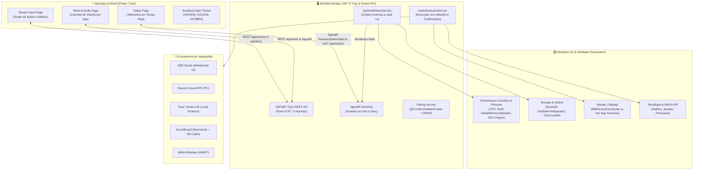

<div align="center">


# Command

**Controle de PC e telemetria de hardware para Windows via aplicativo Android/Flutter, baseado no DroidDeck.**

[](https://github.com/ggfto/DroidDeck)
[](LICENSE)

<br/>



</div>

---

## 🎯 Sobre o Command

O **Command** é uma solução de controle e telemetria de PC pessoal para Windows através de um aplicativo móvel Android. Ele é desenvolvido como um **in-tree fork ativo do [DroidDeck v1.9.1](https://github.com/ggfto/DroidDeck)**, projeto criado por Gabriel Freitas ([@ggfto](https://github.com/ggfto)), de quem vem a ideia original (veja [Licença e atribuição](#-licença-e-atribuição)), combinando todo o ecossistema comprovado do DroidDeck com as capacidades avançadas de telemetria e o design Amethyst Dark do Command.

### ✨ O que o projeto oferece:
- **Base DroidDeck v1.9.1 completa:**
  - ⌨️ Teclas de atalho e macros graváveis pelo teclado.
  - 🪟 Troca rápida de dispositivos de áudio, bloquear tela, suspender.
  - ⏱️ Timers, cronômetros, pomodoros e contadores integrados.
  - 🎮 Atalhos de jogos da Steam com capa automática.
  - 🔊 Mixer de áudio por aplicativo em tempo real.
  - 💬 Integração completa com Discord (mute, ensurdecer, canais, soundboard).
  - 🎥 Controle avançado de OBS Studio via WebSocket (cenas, gravação, transmissão, áudio).
  - 💡 Casa inteligente via Home Assistant e Tuya / Smart Life.
  - 🎧 Spotify, Twitch e YouTube com status ao vivo.
  - 🖥️ Gerenciamento e troca dinâmica entre múltiplos PCs.
  - 📱 Pareamento seguro e imediato via QR code e chave de API local (`droiddeck://pair`).
- **Extensões Command (v1.1.0 Estável):**
  - 📊 Telemetria detalhada de hardware (CPU, Memória RAM, Discos, Uptime, GPU, Bateria e Temperatura).
  - 🎨 Tema visual Command Amethyst Dark (`#050408`, `#161424`, `#A78BFA`) e cartões de status do sistema.
  - 🌐 Configurador Web Flutter integrado em `wwwroot/` (servido em `http://localhost:4787` com resolução explícita de `WebRootPath` e auto-autenticação via loopback).
  - 🛡️ Permissões granulares por dispositivo (`ViewerOnly` vs `FullControl`) e guardião de PIN/Biometria.
  - 🔐 Backup e restauração criptografada AES-256-GCM + PBKDF2-SHA256 (100.000 iterações).
  - 🔄 Verificação de atualização e integridade de pacotes via SHA-256 (Velopack ready).
  - ⚡ Controle de energia remoto seguro (Wake-on-LAN, Bloqueio de Sessão e Suspensão).
  - 🔄 Rotinas encadeadas determinísticas de automação e Modo Dock contínuo.
  - 🤖 Suporte arquitetural para o assistente local opcional Hermes (100% funcional sem IA).

---

## 🧭 Navegação rápida do projeto

| Pergunta | Arquivo |
|---|---|
| Onde paramos e qual é a próxima ação? | [STATE.md](STATE.md) |
| Qual é o produto, escopo e metas? | [PROJECT.md](PROJECT.md) |
| Quais são os gates e a sequência oficial? | [ROADMAP.md](ROADMAP.md) |
| Qual é a referência visual e design tokens? | [DESIGN.md](DESIGN.md) e [referências do Stitch](references/stitch/README.md) |
| Quais decisões de arquitetura foram tomadas? | [docs/DECISIONS.md](docs/DECISIONS.md) |
| Como registrar evidência e critérios de aceite? | [docs/RELEASE_CHECKLIST.md](docs/RELEASE_CHECKLIST.md) |
| Quais regras os agentes e desenvolvedores seguem? | [AGENTS.md](AGENTS.md) |
| Documentação detalhada do DroidDeck? | [website/docs/pt/](website/docs/pt/) ou [website/docs/en/](website/docs/en/) |

---

## 🧩 Arquitetura do repositório

```text
DroidDeck/             Backend C# (.NET 8 WinForms Tray + ASP.NET Core + SignalR + API REST)
app/                   Aplicativo móvel e configurador web em Flutter (Dart)
tests/DroidDeck.Tests/ Suíte de testes unitários e de integração do backend
scripts/               Scripts de build, empacotamento e deploy do frontend web
website/               Documentação MkDocs e site institucional (EN/PT)
docs/                  Decisões de arquitetura (ADRs), roadmap, manual e checklists
contracts/             Especificações OpenAPI e schemas da API
```



---

## 🛠️ Compilação e testes locais

O repositório possui ferramentas e SDKs homologados para execução imediata:

### Backend (.NET 8)
```powershell
# Executar a suíte de testes do backend
research\upstream\.tools\dotnet-8.0.426\dotnet.exe test DroidDeck.sln

# Executar o backend em modo Tray
research\upstream\.tools\dotnet-8.0.426\dotnet.exe run --project DroidDeck

# Executar o backend em modo headless
research\upstream\.tools\dotnet-8.0.426\dotnet.exe run --project DroidDeck -- --headless
```

### Frontend (Flutter)
```powershell
cd app

# Obter dependências
..\research\upstream\.tools\flutter\bin\flutter.bat pub get

# Executar testes
..\research\upstream\.tools\flutter\bin\flutter.bat test
```

---

## 📄 Licença e atribuição

O Command é um **fork** do [DroidDeck](https://github.com/ggfto/DroidDeck), criado por **Gabriel Freitas ([@ggfto](https://github.com/ggfto))**. A ideia original e a base do projeto (Bridge Windows, app companion, pareamento por QR, integrações com OBS, Discord, Tuya, Soundboard, Mixer, Steam e outras) são trabalho dele. O histórico de commits do DroidDeck está preservado neste repositório. Obrigado, Gabriel! 💜

O Command acrescenta telemetria, ações autorizadas, captura de tela, transferências, Hermes, rotinas, Wake-on-LAN, segurança por dispositivo, backup criptografado e auto-update sobre essa base.

- O backend .NET é distribuído sob a licença [Apache 2.0](LICENSE), a mesma do DroidDeck.
- O aplicativo Flutter é distribuído sob a licença [GPL 3.0](app/LICENSE), a mesma do app do DroidDeck.
- A integração com o Hermes (aba Hermes da v1.5) se baseia no protocolo e na documentação do [Hermes-Relay](https://github.com/Codename-11/hermes-relay), da Axiom Labs ([@Codename-11](https://github.com/Codename-11)), licença MIT, e no [Hermes Agent](https://github.com/NousResearch/hermes-agent), da Nous Research. Obrigado pelo trabalho aberto! 💜
- Os arquivos alterados em relação ao upstream estão identificados no histórico Git (base: DroidDeck v1.9.1, `5cd2ddc`).
