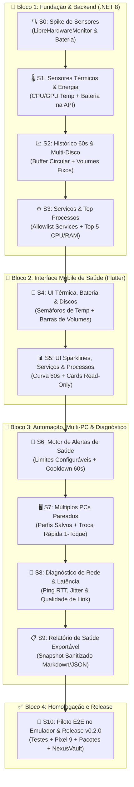

# Command — Roadmap v0.2 (Saúde, Diagnóstico, Alertas e Múltiplos PCs)

- **Estado:** `PLANNED / READY`
- **Data de Criação:** 2026-10-17
- **Pré-requisito:** MVP v0.1.0 concluído e auditado (`docs/MVP_APPROVAL.md` — 96.67% PASS na F9)
- **Objetivo da Onda v0.2:** Expandir a visibilidade operacional e a resiliência do Command em **11 fases bem divididas (S0 a S10)**, cobrindo sensores térmicos, bateria, histórico gráfico de 60s, múltiplos discos, serviços do Windows, top processos consumidores, alertas configuráveis, múltiplos PCs pareados, diagnóstico de latência e exportação de relatório de saúde.

---

## 1. Mapa Visual das Fases (S0 a S10)

---

## 2. Tabela Resumo de Fases (S0 a S10)

| Fase | Bloco | Nome da Fase | Entrega Verificável | Depende de | Estado |
| :--- | :--- | :--- | :--- | :--- | :--- |
| **S0** | Backend | **Spike de Sensores e Energia** | Relatório técnico `S0_SPIKE.md` validando leitura térmica e bateria com/sem Admin | MVP v0.1 | `DONE` |
| **S1** | Backend | **Temperaturas e Bateria na API** | `SystemStats` e `/api/metrics` com `CpuTempC`, `GpuTempC`, `BatteryPercent` e `IsCharging` | S0 | `DONE` |
| **S2** | Backend | **Histórico 60s e Múltiplos Discos** | Janela deslizante de 60 amostras (`History`) e lista de todos os volumes fixos (`Disks`) | S1 | `DONE` |
| **S3** | Backend | **Serviços Windows e Top Processos** | Endpoints read-only `GET /api/services` (allowlist) e `GET /api/processes/top` (Top 5) | S2 | `DONE` |
| **S4** | Mobile | **UI Térmica, Bateria e Multi-Disco** | Badges semafóricos de temperatura, ícone de bateria no topo e lista de discos na `StatusPage` | S1, S2 | `DONE` |
| **S5** | Mobile | **UI Sparklines, Serviços e Processos** | Gráfico Sparkline de 60s, Card de Serviços do Windows e Card Top 5 Processos | S2, S3, S4 | `DONE` |
| **S6** | Mobile | **Motor de Alertas Configuráveis** | Configuração de limiares (CPU/RAM/Temp/Disco/Bateria) + Banner de alerta com *cooldown* 60s | S4, S5 | `DONE` |
| **S7** | Mobile | **Gestão de Múltiplos PCs** | Persistência de múltiplos PCs pareados + Seletor rápido 1-toque no topo da `StatusPage` | S6 | `DONE` |
| **S8** | Fullstack | **Diagnóstico de Latência e Rede** | Medição contínua de RTT (`latencyMs`), qualidade do link e diagnóstico LAN/Tailscale | S7 | `DONE` |
| **S9** | Mobile | **Exportação de Relatório de Saúde** | Gerador de diagnóstico sanitizado do PC (Markdown/JSON) com compartilhamento nativo | S8 | `READY` |
| **S10** | QA/Release | **Validação E2E e Release v0.2.0** | Testes automatizados, piloto no emulador Pixel 9, pacotes `v0.2.0`, Vault e Git push | S9 | `PLANNED` |

---

## 3. Regras Inegociáveis da v0.2

1. **Zero Falha por Ausência de Sensor:** Em PCs, VMs ou sessões sem privilégio de Administrador onde sensores térmicos não estejam acessíveis, o Bridge deve retornar `null` graciosamente sem travar a telemetria.
2. **Zero Execução ou Kill Arbitrário:** O monitoramento de serviços (`S3`) e de top processos (`S3`) é **estritamente somente leitura**. O encerramento continua restrito aos aplicativos com `CanKill = true` da allowlist.
3. **Sem Spam de Alertas:** Alertas de sobrecarga (`S6`) devem respeitar um *cooldown* mínimo de 60 segundos entre notificações da mesma métrica.
4. **Privacidade em Diagnósticos:** O relatório exportável (`S9`) nunca deve incluir `apiKey`, tokens, variáveis de ambiente ou caminhos pessoais fora do resumo sanitizado.
5. **Independência de IA Mantida:** Todas as 11 fases funcionam 100% sem Hermes.

---

## 4. Checklists Detalhados por Fase

### 🔍 Fase S0 — Spike Técnico: Sensores de Hardware e Energia
**Objetivo:** Comprovar a leitura real de sensores térmicos e bateria no host Windows e definir o fallback seguro sem elevação UAC.

- [x] **S0-01:** Avaliar pacote `LibreHardwareMonitorLib` (MPL-2.0) no projeto `DroidDeck` (.NET 8).
- [x] **S0-02:** Testar leitura de temperatura de CPU (Package/Core) e GPU (Core/Hotspot) em sessão normal vs Administrador.
- [x] **S0-03:** Validar leitura de bateria e estado de tomada via Win32 `GetSystemPowerStatus`.
- [x] **S0-04:** Registrar resultados, licença MPL-2.0 e matriz de fallback em `docs/evidence/v0.2/S0_SPIKE.md`.

---

### 🌡️ Fase S1 — Backend: Sensores Térmicos (CPU/GPU) e Bateria na API
**Objetivo:** Enriquecer o `SystemMonitorService` com dados térmicos e de bateria em tempo real.

- [x] **S1-01:** Adicionar `CpuTempC` (`float?`), `GpuTempC` (`float?`), `BatteryPercent` (`int?`), `IsCharging` (`bool?`) e `HasBattery` (`bool`) em `DroidDeck/Models/SystemStats.cs`.
- [x] **S1-02:** Implementar provedor isolado `HardwareSensorProvider.cs` com cache e tratamento de exceções para não bloquear o loop de 1s.
- [x] **S1-03:** Expor os novos campos em `GET /api/metrics` e no evento SignalR `ReceiveSystemStats`.
- [x] **S1-04:** Criar testes unitários em `DroidDeck.Tests/HardwareSensorsTests.cs` cobrindo leituras válidas e fallback `null`.

---

### 📈 Fase S2 — Backend: Histórico Deslizante (60s) e Múltiplos Volumes de Disco
**Objetivo:** Manter histórico recente de carga no Bridge e listar todos os discos fixos do PC.

- [x] **S2-01:** Criar modelo `MetricSampleDto` (`TimestampUtc`, `Cpu`, `Ram`, `Gpu`, `CpuTempC`, `GpuTempC`) e buffer circular de 60 posições em `SystemMonitorService.cs`.
- [x] **S2-02:** Criar modelo `DiskVolumeDto` (`Name`, `Label`, `TotalGB`, `AvailableGB`, `UsagePercent`) enumerando todos os drives `DriveType.Fixed` prontos.
- [x] **S2-03:** Incluir `History` (últimos 60s) e `Disks` no payload de `GET /api/metrics`.
- [x] **S2-04:** Criar testes unitários em `DroidDeck.Tests/HistoryAndDisksTests.cs` validando rotação do buffer de 60 amostras e múltiplos volumes.

---

### ⚙️ Fase S3 — Backend: Serviços Windows e Top 5 Processos (Somente Leitura)
**Objetivo:** Expor visibilidade sobre serviços essenciais e quais processos estão consumindo mais CPU/RAM no momento.

- [x] **S3-01:** Criar `WindowsServiceMonitor.cs` com allowlist configurável de serviços (`Tailscale`, `Spooler`, `WSearch`, `WinDefend`, `Docker`) e endpoint `GET /api/services`.
- [x] **S3-02:** Criar `TopProcessesService.cs` e endpoint `GET /api/processes/top` retornando os Top 5 processos por uso de RAM e CPU (apenas `name`, `pid`, `memoryMB`, `cpuPercent`, sem caminhos sensíveis).
- [x] **S3-03:** Garantir que nenhum endpoint de `S3` exponha ações de parada/encerramento fora da allowlist da Fase F4.
- [x] **S3-04:** Criar testes xUnit em `DroidDeck.Tests/ServicesAndProcessesTests.cs`.

---

### 🎨 Fase S4 — Frontend Mobile: UI Térmica, Bateria e Múltiplos Discos
**Objetivo:** Exibir temperaturas, estado da bateria do PC e todos os discos fixos na `StatusPage`.

- [x] **S4-01:** Adicionar badges semafóricos de temperatura nos cards de CPU e GPU ($\le 65^\circ\text{C}$ Verde `#10B981`, $66\text{--}80^\circ\text{C}$ Âmbar `#F59E0B`, $> 80^\circ\text{C}$ Vermelho `#EF4444`, ou `N/D`).
- [x] **S4-02:** Adicionar pill de **Bateria do PC** (`%` + ícone de raio quando carregando) no cabeçalho da `StatusPage` quando `hasBattery == true`.
- [x] **S4-03:** Expandir visualização de armazenamento para listar todos os volumes fixos (`C:`, `D:`, etc.) com barras de progresso individuais.
- [x] **S4-04:** Criar testes de widget em `app/test/thermal_and_disks_ui_test.dart`.

---

### 📊 Fase S5 — Frontend Mobile: Gráficos Sparkline (60s), Serviços e Top Processos
**Objetivo:** Dar contexto histórico visual (60s) e exibir os cards de Serviços e Top Processos na `StatusPage`.

- [x] **S5-01:** Criar componente leve `MetricSparkline` (`CustomPainter`) para desenhar a curva dos últimos 60s de CPU e RAM com gradiente Amethyst (`#A78BFA`).
- [x] **S5-02:** Criar card **Serviços do Windows** na `StatusPage` exibindo status (`Ativo`, `Parado`, `Ausente`) com badge colorido.
- [x] **S5-03:** Criar card **Top Processos (CPU / RAM)** exibindo os 5 maiores consumidores atuais em fonte monoespaçada.
- [x] **S5-04:** Criar testes de widget em `app/test/sparkline_and_services_ui_test.dart`.

---

### 🚨 Fase S6 — Frontend Mobile: Motor de Alertas de Saúde e Cooldown
**Objetivo:** Detectar anomalias de recursos e alertar o usuário sem gerar notificações repetitivas.

- [x] **S6-01:** Criar `HealthAlertService` no Flutter com limiares configuráveis (padrões: CPU $\ge 90\%$, RAM $\ge 90\%$, Temp $\ge 85^\circ\text{C}$, Disco $\ge 95\%$, Bateria $\le 15\%$).
- [x] **S6-02:** Implementar controle de *cooldown* de 60 segundos por tipo de alerta e botão para silenciar/dispensar.
- [x] **S6-03:** Exibir banner de alerta ativo no topo da `StatusPage` e seção de configuração de limites na `ConfigPage`.
- [x] **S6-04:** Criar testes unitários e de widget em `app/test/health_alerts_test.dart`.

---

### 🖥️ Fase S7 — Frontend Mobile: Gestão de Múltiplos PCs (`PcProfileManager`)
**Objetivo:** Permitir salvar vários computadores pareados e alternar entre eles com 1 toque.

- [x] **S7-01:** Criar modelo `PcProfile` (`id`, `name`, `host`, `port`, `apiKey`, `lastConnectedAt`) persistido localmente no `SharedPreferences` / storage seguro.
- [x] **S7-02:** Migrar automaticamente a conexão atual para o primeiro perfil salvo sem perder o pareamento existente.
- [x] **S7-03:** Adicionar seletor rápido de PC no cabeçalho da `StatusPage` e tela de gerenciamento (adicionar via QR, renomear, excluir) na `ConfigPage`.
- [x] **S7-04:** Criar testes em `app/test/pc_profile_manager_test.dart` validando persistência e troca de conexão ativa.

---

### 📡 Fase S8 — Fullstack: Diagnóstico de Conectividade e Latência (Ping / RTT)
**Objetivo:** Medir a qualidade da conexão entre Android e PC em tempo real e facilitar troubleshooting de rede.

- [x] **S8-01:** Adicionar endpoint leve `GET /api/ping` retornando `serverTimeUtc` e `hostName` com overhead mínimo.
- [x] **S8-02:** Calcular RTT (`latencyMs`) e variação (`jitterMs`) no app Android a cada ciclo de atualização da `StatusPage`.
- [x] **S8-03:** Exibir badge de latência (ex.: `12 ms · LAN`) junto ao status Online, com cores de qualidade ($\le 50\text{ ms}$ Verde, $51\text{--}150\text{ ms}$ Âmbar, $> 150\text{ ms}$ Vermelho).
- [x] **S8-04:** Criar testes em `app/test/network_latency_test.dart`.

---

### 📋 Fase S9 — Frontend Mobile: Exportação de Relatório de Saúde Sanitizado
**Objetivo:** Permitir exportar ou compartilhar um resumo técnico da saúde do PC em 1 toque.

- [ ] **S9-01:** Criar `HealthReportGenerator` gerando relatório estruturado em Markdown e JSON com métricas atuais, temperaturas, discos, serviços, top processos e latência.
- [ ] **S9-02:** Garantir sanitização rigorosa (zero tokens, zero chaves, zero IPs privados completos se marcado como sanitizado).
- [ ] **S9-03:** Adicionar botão **"Exportar Diagnóstico"** na `StatusPage` abrindo preview e folha de compartilhamento nativa (`SharePlus`).
- [ ] **S9-04:** Criar testes unitários em `app/test/health_report_generator_test.dart` validando formato e ausência de dados sensíveis.

---

### 🏁 Fase S10 — Validação E2E no Emulador Pixel 9, Pacote `v0.2.0` e Homologação
**Objetivo:** Comprovar todas as entregas da v0.2 (S0 a S9) no emulador Android real, gerar pacotes `v0.2.0` e atualizar o NexusVault.

- [ ] **S10-01:** Executar suíte completa de testes automatizados (`dotnet test` + `flutter test` + `flutter analyze` exit 0).
- [ ] **S10-02:** Gerar pacotes instaláveis `dist/command-bridge-v0.2.0-win-x64.zip` e `dist/command-app-v0.2.0-debug.apk` com hashes SHA-256.
- [ ] **S10-03:** Executar bateria E2E ao vivo no emulador Pixel 9 (`emulator-5554`) validando temperaturas, bateria, sparklines, discos, serviços, top processos, alertas, multi-PC, latência e exportação de relatório.
- [ ] **S10-04:** Salvar capturas em `docs/assets/emulator_v02_*.png`, atualizar `STATE.md`, sincronizar com o NexusVault (`01_Projetos/Command.md` e `NOW.md`) e realizar commit + push.

---

## 5. Checklist Mestre de Progresso (v0.2)

- [x] **S0** — Spike Técnico: Sensores de Hardware e Energia (`docs/evidence/v0.2/S0_SPIKE.md`)
- [x] **S1** — Backend: Sensores Térmicos (CPU/GPU) e Bateria na API
- [x] **S2** — Backend: Histórico Deslizante (60s) e Múltiplos Volumes de Disco
- [x] **S3** — Backend: Serviços Windows e Top 5 Processos (Somente Leitura)
- [x] **S4** — Mobile: UI Térmica, Bateria e Múltiplos Discos
- [x] **S5** — Mobile: Gráficos Sparkline (60s), Serviços e Top Processos
- [x] **S6** — Mobile: Motor de Alertas de Saúde e Cooldown Anti-Spam
- [x] **S7** — Mobile: Gestão de Múltiplos PCs (`PcProfileManager`)
- [x] **S8** — Fullstack: Diagnóstico de Conectividade e Latência (Ping / RTT)
- [ ] **S9** — Mobile: Exportação de Relatório de Saúde Sanitizado
- [ ] **S10** — QA/Release: Piloto E2E no Emulador Pixel 9, Pacotes `v0.2.0` e NexusVault
