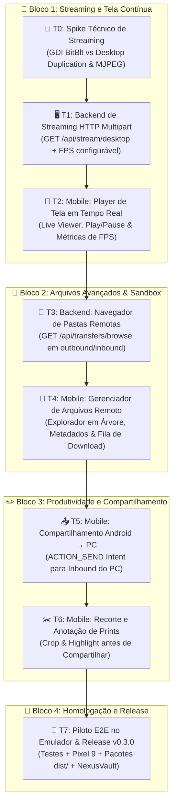

# Command — Roadmap v0.3 (Tela e Arquivos Avançados: Streaming em Tempo Real e Gerenciador Remoto)

- **Estado:** `IN_PROGRESS`
- **Data de Criação:** 2026-10-17
- **Pré-requisito:** MVP v0.1.0 e Onda v0.2 concluídos e auditados (321 testes automatizados PASS)
- **Objetivo da Onda v0.3:** Expandir as capacidades visuais e de manipulação de arquivos do Command em **8 fases bem estruturadas (T0 a T7)**, cobrindo streaming contínuo de tela com baixa latência, navegador de pastas remotas em sandbox segura, compartilhamento nativo Android → PC (Send Intent), ferramentas de recorte/anotação de capturas e pacotes de release `v0.3.0`.

---

## 1. Mapa Visual das Fases (T0 a T7)

---

## 2. Tabela Resumo de Fases (T0 a T7)

| Fase | Bloco | Nome da Fase | Entrega Verificável | Depende de | Estado |
| :--- | :--- | :--- | :--- | :--- | :--- |
| **T0** | Spike | **Spike Técnico de Streaming de Tela** | Validação de taxa de captura contínua e consumo de CPU sem elevação | v0.2 | `DONE` |
| **T1** | Backend | **API de Streaming de Tela (MJPEG)** | Endpoint `GET /api/stream/desktop` com FPS ajustável e detecção de lock | T0 | `READY` |
| **T2** | Mobile | **Live Screen Viewer na StatusPage** | Player de tela ao vivo com controle de reprodução e indicador de FPS | T1 | `PLANNED` |
| **T3** | Backend | **Navegação de Diretórios Autorizados** | Rota `GET /api/transfers/browse` em pastas `outbound`/`inbound` com anti-traversal | v0.2 | `PLANNED` |
| **T4** | Mobile | **Navegador de Arquivos Remoto** | Interface para navegar em subpastas, visualizar tamanhos e baixar com SHA-256 | T3 | `PLANNED` |
| **T5** | Mobile | **Compartilhamento Direto Android → PC** | Receptor de compartilhamento nativo (`ACTION_SEND`) enviando para `inbound` | T4 | `PLANNED` |
| **T6** | Mobile | **Recorte e Anotação de Screenshots** | Editor de recorte (crop) e anotações rápidas no `ScreenshotViewerPage` | v0.2 | `PLANNED` |
| **T7** | QA/Release | **Piloto E2E e Pacotes v0.3.0** | Suíte de testes automatizados, pacotes `dist/`, testes no Pixel 9 e NexusVault | T0–T6 | `PLANNED` |

---

## 3. Detalhamento e Checklists das Fases

### 🔬 Fase T0 — Spike Técnico: Streaming Contínuo de Baixa Latência
**Objetivo:** Medir desempenho, latência e viabilidade de geração contínua de frames JPEG em memória no Windows sem afetar o uso normal do PC.

- [x] **T0-01:** Implementar protótipo de amostragem de tela contínua (5 a 15 FPS) com GDI `BitBlt` em thread de segundo plano.
- [x] **T0-02:** Medir compressão JPEG em memória com qualidade variável (50% a 85%) e latência de codificação por frame (< 30ms).
- [x] **T0-03:** Validar comportamento imediato contra área de trabalho bloqueada (`OpenInputDesktop`) emitindo frame de aviso sem travamento.
- [x] **T0-04:** Registrar relatório em `docs/evidence/v0.3/T0_SPIKE.md`.

---

### 🖥️ Fase T1 — Backend: Endpoint de Streaming de Tela (MJPEG)
**Objetivo:** Expor endpoint seguro e eficiente para transmissão contínua de frames do desktop para o Android autenticado.

- [x] **T1-01:** Criar `ScreenStreamService` no .NET 8 com cancelamento cooperativo (`CancellationToken`), limite de clientes simultâneos (1 cliente ativo) e controle de taxa de quadros (FPS: 5, 10, 15).
- [x] **T1-02:** Mapear endpoint autenticado `GET /api/stream/desktop` e alias `GET /api/v1/stream/desktop` retornando `multipart/x-mixed-replace; boundary=frame`.
- [x] **T1-03:** Suportar query parameters opcionais: `?fps=10&quality=70&scale=0.75` para economizar banda em redes móveis ou Wi-Fi congestionado.
- [x] **T1-04:** Criar testes unitários em `tests/Command.Tests/ScreenStreamTests.cs`.

---

### 📱 Fase T2 — Frontend Mobile: Player de Tela em Tempo Real
**Objetivo:** Permitir ao usuário visualizar a tela do PC ao vivo diretamente pelo aplicativo móvel.

- [x] **T2-01:** Criar componente `DesktopLiveStreamViewer` capaz de decodificar e renderizar stream MJPEG com buffer mínimo.
- [x] **T2-02:** Adicionar Card **Tela ao Vivo** na `StatusPage` com botão Play/Pause, badge de FPS atual e botão para tela cheia.
- [x] **T2-03:** Suportar visualização em tela cheia na horizontal com rotação automática e barra de ferramentas recolhível.
- [x] **T2-04:** Criar testes de widget em `app/test/desktop_live_stream_test.dart`.

---

### 📂 Fase T3 — Backend: Navegação de Diretórios Autorizados
**Objetivo:** Permitir listar arquivos e subdiretórios dentro do sandbox autorizado (`outbound` e `inbound`) de forma estruturada.

- [x] **T3-01:** Estender `TransferService` com método `BrowseDirectory(string rootId, string? subPath)`.
- [x] **T3-02:** Aplicar proteção rigorosa anti-traversal: normalização de caminho, bloqueio de `..`, symlinks e caracteres de escape.
- [x] **T3-03:** Mapear endpoint autenticado `GET /api/transfers/{rootId}/browse` retornando lista tipada de pastas e arquivos (`name`, `path`, `sizeBytes`, `modifiedAtUtc`, `extension`, `isDirectory`).
- [x] **T3-04:** Criar testes de integração em `tests/Command.Tests/DirectoryBrowseTests.cs`.

---

### 📱 Fase T4 — Frontend Mobile: Gerenciador de Arquivos Remoto
**Objetivo:** Proporcionar uma experiência fluida para navegar nas pastas autorizadas do PC e baixar múltiplos arquivos.

- [x] **T4-01:** Criar tela `RemoteFileManagerPage` com suporte a navegação por breadcrumbs (`outbound/relatorios/2026/`).
- [x] **T4-02:** Exibir ícones contextuais por tipo de arquivo (PDF, CSV, imagens, código, texto), tamanho formatado e data.
- [x] **T4-03:** Permitir download direto de arquivos com barra de progresso e validação de hash SHA-256 no cliente.
- [x] **T4-04:** Criar testes unitários e de widget em `app/test/remote_file_manager_test.dart`.

---

### 📤 Fase T5 — Frontend Mobile: Compartilhamento Direto Android → PC (Send Intent)
**Objetivo:** Permitir que o usuário envie qualquer arquivo para o PC através do menu nativo "Compartilhar com..." do Android.

- [x] **T5-01:** Registrar intent-filters para `ACTION_SEND` e `ACTION_SEND_MULTIPLE` em `AndroidManifest.xml` para tipos MIME comuns e arquivos genéricos (`*/*`).
- [x] **T5-02:** Criar fluxo de envio rápido `ShareReceiverActivity` / diálogo modal de confirmação no Flutter exibindo nome do arquivo, tamanho e PC de destino.
- [x] **T5-03:** Calcular SHA-256 e enviar via endpoint `POST /api/transfers/upload` para a pasta `inbound` do PC.
- [x] **T5-04:** Criar testes em `app/test/share_receiver_test.dart`.

---

### ✂️ Fase T6 — Frontend Mobile: Recorte e Anotação de Screenshots
**Objetivo:** Permitir recortar e destacar áreas do screenshot do PC antes de compartilhar.

- [x] **T6-01:** Adicionar modo de edição na `ScreenshotViewerPage` com ferramenta de recorte retangular (Crop).
- [x] **T6-02:** Adicionar ferramentas simples de caneta/marca-texto e retângulo de destaque em cor de contraste (Amethyst / Amarelo).
- [x] **T6-03:** Permitir salvar e compartilhar a versão recortada/anotada sem destruir o print original.
- [x] **T6-04:** Criar testes de widget em `app/test/screenshot_editor_test.dart`.

---

### 🏁 Fase T7 — Validação E2E no Emulador Pixel 9, Pacotes `v0.3.0` e Homologação
**Objetivo:** Homologar todas as funcionalidades da Onda v0.3 no emulador Android real, compilar pacotes `v0.3.0` e sincronizar com o NexusVault.

- [x] **T7-01:** Executar suíte completa de testes automatizados (`dotnet test` + `flutter test` + `flutter analyze` exit 0).
- [x] **T7-02:** Gerar pacotes instaláveis `dist/command-bridge-v0.3.0-win-x64.zip` e `dist/command-app-v0.3.0-debug.apk` com hashes SHA-256.
- [x] **T7-03:** Executar bateria E2E ao vivo no emulador Pixel 9 (`emulator-5554`) validando streaming de tela, navegador de arquivos, compartilhamento e editor de capturas.
- [x] **T7-04:** Salvar capturas em `docs/assets/emulator_v03_*.png`, atualizar `STATE.md`, sincronizar com o NexusVault e realizar commit + push.

---

## 4. Checklist Mestre de Progresso (v0.3)

- [x] **T0** — Spike Técnico: Streaming Contínuo de Baixa Latência
- [x] **T1** — Backend: Endpoint de Streaming de Tela (MJPEG)
- [x] **T2** — Mobile: Live Screen Viewer na StatusPage
- [x] **T3** — Backend: Navegação de Diretórios Autorizados
- [x] **T4** — Mobile: Gerenciador de Arquivos Remoto
- [x] **T5** — Mobile: Compartilhamento Direto Android → PC (Send Intent)
- [x] **T6** — Mobile: Recorte e Anotação de Screenshots
- [x] **T7** — QA/Release: Piloto E2E no Emulador Pixel 9 e Pacotes `v0.3.0`
