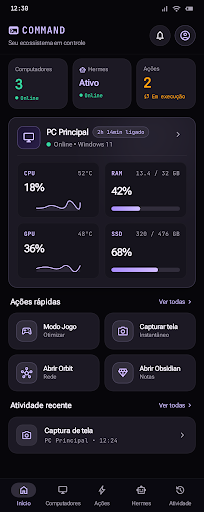
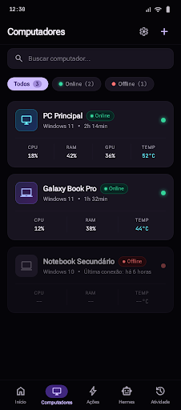
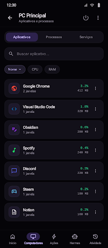
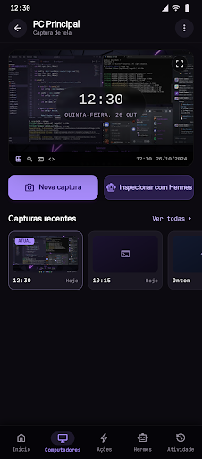
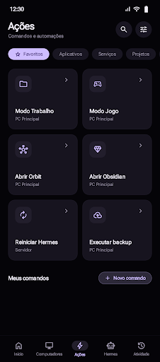
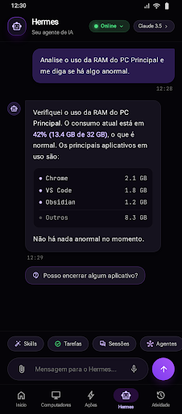
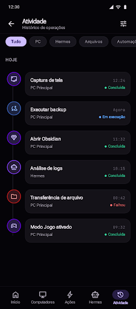
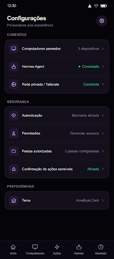
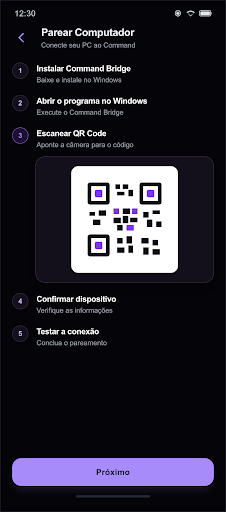

# Referências visuais — Stitch

Projeto: [COMMAND Android Control Center](https://stitch.withgoogle.com/projects/5594973370148065118) · projeto ID `5594973370148065118` · telas MOBILE.

As capturas locais preservam as telas numeradas e as explorações adicionais existentes no momento da coleta. Os nomes incluem os números de tela e o identificador Stitch no manifesto para manter rastreabilidade. Elas orientam composição e aparência; não confirmam escopo de produto nem equivalem a aceite visual da implementação.

- `screens/` — capturas de telas completas do app.
- `assets/` — imagens anexadas ou usadas como referência no canvas do Stitch.
- Fonte de design: [DESIGN.md](../../DESIGN.md).
- Coletadas em 2026-10-12. IDs de origem, tamanhos e SHA-256 ficam em `manifest.json`.

## Telas numeradas

As telas exploratórias adicionais ficam em `screens/exploracao-*.png`.

